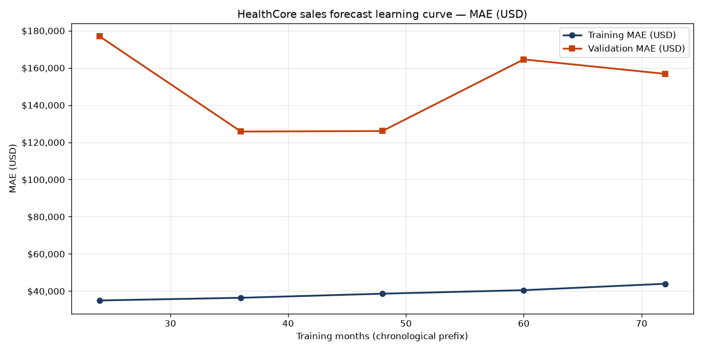

# HealthCore sales-forecast evaluation

## Executive diagnosis and staging recommendation

**Diagnosis: Overfitting.** Do not stage this model. The next change is stronger regularization.

Raise min_samples_leaf above 2 or lower max_depth below 5 on the frozen RandomForestRegressor (n_estimators=100, max_depth=5, min_samples_leaf=2, random_state=42). The 2022 and 2023 folds still show an average gap ratio of 0.74: validation MAE exceeds in-sample training MAE by $118,460.63 on average. Adding trees or depth would not be the next change.

This verdict uses the five training-period folds and the learning curve. The held-out years 2024 and 2025 are not cross-validation folds, and they were not used to choose the diagnosis or the staging sentence.

## Company context and the cost of an error

HealthCore is the assigned company. The forecast series is one consolidated monthly revenue row, not one row per clinic. The target is `revenue_usd`, in US dollars. `CONTEXT.md` does not say whether overestimating revenue or underestimating revenue is more costly, so this report does not rank those directions. MAE is the primary metric: it is the typical absolute miss in dollars, and the existing forest was selected with MAE. RMSE is reported beside it because squaring gives extra weight to large misses. Neither metric is universally better.

## Dataset scope

Source: `data/raw/healthcore_sales.csv`. Training years are 2016–2023. After the 12-month lag warmup, 84 feature rows remain, covering 2017–2023. The horizon is rolling one month ahead. The entity is `region=consolidated`. The frequency is one row per month. 2024 and 2025 stay outside the folds.

## Model and features

The model is the existing `RandomForestRegressor` with frozen settings n_estimators=100, max_depth=5, min_samples_leaf=2, random_state=42. Settings were read from `data/eval/sales_forecast/metrics.json` and were not searched again. No scaler is used. Features: `month_num`, `month_sin`, `month_cos`, `time_index`, `revenue_lag_1`, `revenue_lag_12`, `revenue_roll_mean_3`, `revenue_roll_mean_12`, `visits_lag_1`. Same-month `visits_count` and `avg_revenue_per_visit_usd` stay excluded.

## Cross-validation design

Five expanding year folds cover validation years 2019, 2020, 2021, 2022, 2023. Each training window is sorted, and its latest month is strictly earlier than the validation year's first month. Inside a validation year, a month may use the real revenue from earlier months, because the task is one month ahead. The forest for each fold is fit on that fold's training rows only. Validation years 2019, 2020, 2021 overlap the months that chose these settings, so those three folds can make the five-fold mean look rosy. Seasonal naive is `revenue_lag_12` on the same validation rows. The spread is the sample standard deviation, which divides by 4 when there are five folds.

## Fold results

Amounts are USD.

| Validation year | Training months | Training MAE | Training RMSE | Validation MAE | Validation RMSE | Seasonal-naive validation MAE |
| --- | ---: | ---: | ---: | ---: | ---: | ---: |
| 2019 | 24 | 34953.05 | 42857.95 | 176919.69 | 191342.30 | 183511.89 |
| 2020 | 36 | 36388.62 | 45594.71 | 125764.96 | 143527.42 | 105127.29 |
| 2021 | 48 | 38594.01 | 47443.89 | 126026.35 | 160900.43 | 154965.03 |
| 2022 | 60 | 40484.34 | 51475.58 | 164554.51 | 200142.21 | 83579.25 |
| 2023 | 72 | 43933.13 | 55257.12 | 156784.22 | 180591.97 | 178189.38 |

## Mean ± sample standard deviation

- Training MAE: $38,870.63 ± $3,529.07 (sample standard deviation, n=5)
- Training RMSE: $48,525.85 ± $4,896.38 (sample standard deviation, n=5)
- Validation MAE (primary): $150,009.95 ± $23,154.92 (sample standard deviation, n=5)
- Validation RMSE: $175,300.87 ± $23,018.15 (sample standard deviation, n=5)
- Seasonal-naive validation MAE: $141,074.57 ± $44,635.46 (sample standard deviation, n=5)

## Training versus validation error

Training error is the in-sample error on the months just used to fit that fold. A random forest with `min_samples_leaf=2` can look very accurate on those months. Mean training MAE is $38,870.63 ± $3,529.07 (sample standard deviation, n=5). Mean validation MAE is $150,009.95 ± $23,154.92 (sample standard deviation, n=5). The diagnosis uses the 2022–2023 gap, when more history is available, rather than treating every early gap as overfitting.

## Learning curve

Each point is one validation year. Training history grows from 24 months (validation 2019) to 72 months (validation 2023). Validation MAE fell from $176,919.69 to $156,784.22. On the 2022 and 2023 folds, validation MAE exceeds in-sample training MAE by $118,460.63 on average. There is no shaded band, because each point is one chronological prefix rather than a repeated sample. The fold-to-fold spread is the sample standard deviation in the table.



## Fit classification

Overfitting when the average 2022–2023 gap ratio (validation MAE - training MAE) / validation MAE is at least 0.50. Underfitting when that ratio is below 0.50 and mean validation MAE is at least the mean seasonal-naive validation MAE. Reasonably well fitted when that ratio is below 0.50 and mean validation MAE is below the seasonal-naive mean.

The average 2022–2023 gap ratio is 0.74. That gap is $118,460.63 of validation MAE minus training MAE. Mean validation MAE is $150,009.95. Mean seasonal-naive validation MAE is $141,074.57. The classification is **Overfitting**.

## Next action

Raise min_samples_leaf above 2 or lower max_depth below 5 on the frozen RandomForestRegressor (n_estimators=100, max_depth=5, min_samples_leaf=2, random_state=42). The 2022 and 2023 folds still show an average gap ratio of 0.74: validation MAE exceeds in-sample training MAE by $118,460.63 on average. Adding trees or depth would not be the next change.

## Limitations and reproducibility

The 2022–2023 side score fits the forest on feature rows through 2021 (60 months) and scores the next 24 months one month at a time. Its MAE is $174,211.15 and its RMSE is $203,415.64. This score is a limitation check. It is not a sixth cross-validation fold, and it is not included in the five-fold mean.

`CONTEXT.md` does not identify a costlier direction of error. The five-fold mean includes 2019–2021, which helped choose the frozen settings. In-sample training error understates the error of a forest. The learning curve has five chronological points and no uncertainty band.

Re-run from the repository root:

```bash
uv --directory scripts/sales_forecast run python ../eval_sales_forecast.py
```

Fold metrics: `data/eval/sales_forecast/cv_metrics.json`. Learning curve: `data/eval/sales_forecast/learning_curve.png`. Dollar figures in this report are written from that run.
