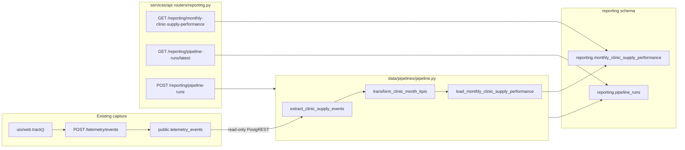

# HealthCore Monthly Clinic Supply Performance — pipeline design

Sprint 1 design for branch `data-pipeline`. Prefect ETL and `/reporting` HTTP shipped in Sprint 2. Subflows, isolated tests, and the staff dashboard shipped in Sprint 3.

Authority: [`pipeline-context.md`](../../pipeline-context.md) and the HealthCore business-performance pipeline context. Approved Sprint 1 plan: [`docs/pipelines/sprint-1-implementation-plan.md`](../../docs/pipelines/sprint-1-implementation-plan.md).

## 1. Current state and business gap

Staff already emit HealthCore-named events from `uis/web` through a single `track()` queue to public `POST /telemetry/events`. Valid items persist (when Supabase credentials exist) as append-only rows in `public.telemetry_events`. Envelope fields (`eventId`, `sessionId`, `userId`, `schemaVersion`, `requestId`) and inventory properties live in `tags` jsonb. The technical report `GET /telemetry/report` answers engineering questions: events per day, error rate, API latency, auth failure rate. It is not clinic-month, has no supply cost, and is not a board pack.

Dr. Okonkwo and Claire still cannot see, by the first working day of the month, how much each of the 12 clinics spent on supplies, how many consumption events occurred, how often stock hit the critical band, or how often expiry waste was flagged. That is the gap this pipeline closes. It does **not** replace `GET /telemetry/report` or write back to `telemetry_events`.

v1 source events (only these four):

| event_type | KPI |
| --- | --- |
| `inbound_order_created` | Supply Cost per Clinic |
| `outbound_order_created` | Supply Consumption Volume (event **count**, not sum of `quantity`) |
| `stock_threshold_triggered` | Critical Stockout Frequency |
| `supply_expiry_flagged` | Expiry Risk Count |

`department` may exist on clinical outbound source events. The destination grain is clinic-month with **no** department column.

## 2. One-sentence pipeline purpose

Produce the Monthly Clinic Supply Performance Report for Dr. Okonkwo and Claire: one UTC clinic-month row per clinic with supply cost, consumption-event count, critical stockout count, and expiry-risk count, sourced only from the four mandatory supply-chain telemetry events.

## 3. Extraction contract

**Source (read-only):** `public.telemetry_events` via the same PostgREST pattern as `app/telemetry/store.py` / `analysis.py` (`SUPABASE_URL` + service role). Never UPDATE/DELETE/INSERT that table from this pipeline.

**Envelope / payload shape** (row + `tags`):

| Field | Where | Notes |
| --- | --- | --- |
| `timestamp` | column | Event time (timestamptz); month assignment uses UTC |
| `event_type` | column | Filter to the four types above |
| `tags.eventId` | jsonb | UUID string; source dedupe key |
| `tags.clinic_id` | jsonb | Integer 1–12 in capture; stored as text `"1"`…`"12"` in reporting |
| `tags.country` | jsonb | `US` or `UK` |
| `tags.quantity` | jsonb | Integer; used with cost, not as the consumption KPI |
| `tags.unit_cost` | jsonb | Number `> 0` on `inbound_order_created` only (additive capture field) |
| `tags.product_id`, `tags.product_category` | jsonb | Not destination dimensions; may appear in quarantine diagnostics without PHI |
| `tags.department` | jsonb | Preserved on source outbound only; not a destination column |
| `tags.userId` | jsonb | Opaque TinyDB id; **never** copied to reporting output or run-error text |

**Cadence:** monthly scheduled run plus on-demand POST. Default window for calendar month `M` (UTC): `[month_start(M), month_start(M+1) + 7 days)`. Events whose UTC month is `M` contribute to month `M` even if they arrive in the first seven days of `M+1`.

**Filters:** `event_type IN` the four types; `timestamp` in the window. Do not join inventory, auth, or any patient-level table.

**Justified extra domain tables:** none for v1 extract. Cost is on the inbound event (`unit_cost`), not `medical_supply`.

**Cost semantics:** there is no `total_cost` property. `event_cost = unit_cost × quantity`. `total_supply_cost` is the sum of `event_cost` for valid inbound events in that clinic-month. Currency is derived from `country` (`US`→`USD`, `UK`→`GBP`), never converted.

## 4. Data flow



Technical report (`GET /telemetry/report` → `app/telemetry/analysis.py`) is a separate read path on the same source and is not in this flow.

## 5. Transformation contract

- **Month:** `month_start` = first day of the UTC calendar month of `timestamp`. Exclusive end of the month is the next month’s first day.
- **Group:** `(clinic_id text, country, month_start)`.
- **Counts:** `supply_consumption_count` = count of `outbound_order_created`; `critical_stockout_count` = count of `stock_threshold_triggered`; `expiry_risk_count` = count of `supply_expiry_flagged`. Do **not** sum `quantity` for consumption.
- **Cost:** sum of `unit_cost * quantity` for `inbound_order_created` only.
- **Currency:** `US`→`USD`, `UK`→`GBP`. Never mix currencies in one row. If a clinic-month somehow has both countries after quarantine, split is not required because a clinic_id maps to one country in capture (`country` comes from the supply’s country); if country conflicts remain, quarantine those events and do not emit a mixed row.
- **Clinic ids:** keep decimal strings `"1"`…`"12"`. Syllabus example `"austin-north"` is illustrative only.
- **Duplicates:** keep the first occurrence of each `tags.eventId`; drop later copies before aggregation.
- **Malformed / invalid (quarantine, do not fail the run):** missing/out-of-range `clinic_id`; country not `US`/`UK`; inbound missing/non-numeric/`<= 0` `unit_cost`; missing/non-integer/`< 1` `quantity` on inbound (cost path); missing `eventId`. Quarantined events increment `events_quarantined` and are omitted from KPI math.
- **Late events:** included when they fall in the extract window and their UTC month is in the recompute set; upsert replaces the clinic-month row.

Empty valid input yields `completed` with `records_processed = 0` and `events_extracted` possibly 0 (silence vs failure: see §8).

## 6. Destination and API contract

### Table (Sprint 2 DDL; not created in Sprint 1)

```sql
create schema if not exists reporting;

create table reporting.monthly_clinic_supply_performance (
  id uuid primary key default gen_random_uuid(),
  clinic_id text not null,
  country text not null,
  month_start date not null,
  total_supply_cost numeric not null default 0,
  supply_consumption_count integer not null default 0,
  critical_stockout_count integer not null default 0,
  expiry_risk_count integer not null default 0,
  currency text not null,
  computed_at timestamptz not null default now(),
  unique (clinic_id, month_start)
);
```

Idempotent load: `INSERT … ON CONFLICT (clinic_id, month_start) DO UPDATE` of the KPI columns, `currency`, and `computed_at`.

This is **not** `telemetry_events`. SQL file in Sprint 2 will follow the `docs/telemetry/telemetry_events.sql` convention (no Alembic in this repo).

### HTTP (Sprint 2; FastAPI in the existing app)

Module mapping (repo-grounded): `services/api/app/reporting/` + `services/api/app/routers/reporting.py` prefix `/reporting`. One process with inventory/auth. JWT `Depends(get_current_user)` on all three routes (same as inventory). Routers import pipeline functions/flows; they do **not** reimplement KPI math.

**`GET /reporting/monthly-clinic-supply-performance`**

- Query: optional `month_start` (`YYYY-MM-DD`, must be a month-start UTC date).
- Default: the latest `month_start` present in the table; if the table is empty, 200 with that month omitted and `clinics: []` (exact empty body is specified in Sprint 2 as `{ "month_start": null, "clinics": [] }` or 404 — **prefer 200 with `month_start: null` and empty list** so the dashboard can show an empty state).
- 400 if `month_start` is present but not the first of a month.
- Response:

```json
{
  "month_start": "2026-07-01",
  "clinics": [
    {
      "clinic_id": "1",
      "country": "US",
      "total_supply_cost": 18420.50,
      "supply_consumption_count": 340,
      "critical_stockout_count": 1,
      "expiry_risk_count": 4,
      "currency": "USD"
    }
  ]
}
```

`clinic_id` values are `"1"`–`"12"`, not `austin-north`.

**`GET /reporting/pipeline-runs/latest`**

- 200: `{ "run_id", "status", "started_at", "finished_at", "records_processed", "events_extracted", "events_quarantined", "window_start", "window_end", "error" }` from the newest `pipeline_runs` row.
- 404 if no runs exist.

**`POST /reporting/pipeline-runs`**

- Optional body `{ "month_start": "2026-07-01" }` to run a specific month; default = previous UTC calendar month (the month that just closed — the board pack).
- Runs `monthly_clinic_supply_performance` **synchronously**.
- 200 with the same metadata shape as `latest` on success.
- 409 if another run has `status = running`.
- 401/403 via existing auth handlers.

Existing `GET /telemetry/report` is unchanged.

## 7. Idempotency and concurrency

- **Source dedupe:** unique `tags.eventId` before transform.
- **Load upsert:** unique `(clinic_id, month_start)`.
- **Rerun / partial load:** a second run over the same window produces the same KPI rows (no duplicate clinic-month keys). Transform is a full recompute of the window’s clinic-months, not incremental add.
- **Late events:** recompute and upsert only clinic-months present in the extract (or all months touched by extracted events).
- **Scheduled + manual overlap:** Sprint 2 in-process lock plus a `running` row; POST returns 409. Sprint 3 optional: Postgres advisory lock if more than one API worker is proven.

Deterministic recovery: if load fails after extract/transform, status `failed`, no silent partial unique-key duplicates (upsert is safe to retry).

## 8. Observability and recovery

### `reporting.pipeline_runs` (Sprint 2)

| Field | Type | Audit rationale |
| --- | --- | --- |
| `run_id` | uuid PK default `gen_random_uuid()` | Correlate Prefect/CLI/API and logs |
| `started_at` | timestamptz not null | Duration; detect stuck `running` |
| `finished_at` | timestamptz null | Null means in-flight |
| `status` | text not null (`running` \| `completed` \| `failed`) | Matches Prefect Running/Completed/Failed |
| `records_processed` | integer not null default 0 | Clinic-month rows upserted |
| `error` | text null | Failure class/message; **no PHI, no emails, no tokens** |
| `window_start` | timestamptz not null | Source lower bound actually queried |
| `window_end` | timestamptz not null | Source exclusive upper bound |
| `events_extracted` | integer not null default 0 | Raw rows returned before quarantine |
| `events_quarantined` | integer not null default 0 | Distinguishes skip vs empty source |

**Silence vs capture failure:** `completed` + `events_extracted = 0` = no telemetry in the window (zero activity). HTTP/PostgREST/database errors during extract or load = `failed` with `error` set. Optional Sprint 3 heartbeat (`emit_clinic_supply_pipeline_heartbeat`) records that the scheduler fired even when extract returns zero.

Checkpoints: the control row is inserted as `running` at start and updated at end. Event-to-run correlation is `run_id` in structured logs (`run_id`, `event_type` counts) without dumping `userId`.

Resume: retry the same window; upsert makes resume safe.

## 9. Prefect mapping (Sprint 2 tasks; Sprint 3 subflows)

| Kind | HealthCore name |
| --- | --- |
| Main flow | `monthly_clinic_supply_performance` |
| Extract subflow | `extract_clinic_supply_events_flow` |
| Transform subflow | `transform_clinic_month_kpis_flow` |
| Load subflow | `load_monthly_clinic_supply_performance_flow` |
| Extract task | `extract_clinic_supply_events` |
| Transform task | `transform_clinic_month_kpis` |
| Load task | `load_monthly_clinic_supply_performance` |
| Optional non-critical | `emit_clinic_supply_pipeline_heartbeat_flow` (`return_state=True`) |
| Block | `healthcore-supabase` (URL + service role; never logged) |

The main flow is the coordinator and invokes the three ETL subflows with explicit window/event/row contracts. Subflows wrap the existing `@task`s (retries and 1h transform cache stay on the tasks). HTTP, CLI, and pytest call `execute_monthly_clinic_supply_performance` (`task.fn()`) so they do not start Prefect’s ephemeral API server.

States used: `Running`, `Completed`, `Failed`. External-service tasks (extract, load) get retries + `retry_delay_seconds` (Sprint 2). Transform caching: `cache_key_fn` over `(window_start, window_end, event fingerprint or count)` with ~1 hour expiration (Sprint 2).

**Schedule:** cron `0 6 1 * *` (06:00 UTC on day 1). Operators POST if the 1st is a weekend and the pack must ship on the next working day.

**CLI:** `python data/pipelines/pipeline.py` from the repo root still runs the complete ETL via `execute_monthly_clinic_supply_performance` (Sprint 2 entry point preserved). Prefect `>=3` is installed with `uv` in `services/api`.

## 10. Application integration design

| Endpoint | Calls | Errors |
| --- | --- | --- |
| `GET /reporting/monthly-clinic-supply-performance` | Read helper on `reporting.monthly_clinic_supply_performance` only (no ETL) | 400 bad `month_start`; 401; 200 empty list |
| `GET /reporting/pipeline-runs/latest` | Read latest `reporting.pipeline_runs` | 404 none; 401 |
| `POST /reporting/pipeline-runs` | `execute_monthly_clinic_supply_performance` in `data/pipelines/` | 409 overlap; 401; 200 metadata |

No KPI formulas in `services/`. `app/telemetry/analysis.py` and `GET /telemetry/report` stay untouched.

Sprint 3 UI: `uis/web` route `/backoffice/reporting/monthly-clinic-supply-performance` fetches the GET KPI endpoint only (plus latest-run status). There is no separate `uis/backoffice` app.

## 11. Resilience questions (Sprint 2 required vs Sprint 3 optional)

| Question | Sprint 2 | Sprint 3 optional |
| --- | --- | --- |
| Duplicate events | Dedupe `eventId` | — |
| Rerun after partial load | Upsert clinic-month | — |
| Late events | 7-day lookback + recompute | Longer lookback if needed |
| Zero activity vs capture failure | `events_extracted` + status | **Shipped:** heartbeat subflow with `return_state=True` |
| Traceability | `pipeline_runs` + `run_id` logs | **Shipped:** latest-run status on the clinic supply dashboard |
| Volume swings | Full-window recompute (12 clinics) | Transform cache already required in Sprint 2 |
| Database outage | Task retries; `failed` row | — |
| Offline browser buffering | Existing `track()` queue/beacon (already shipped) | — |
| Transmission retry / idempotency keys | Existing ingest retries; `eventId` | Explicit idempotency-key header if ingest changes (out of scope unless designed) |
| Concurrent runs | In-process lock + 409 | Advisory lock (not shipped; still one API process) |

## 12. Testing and validation strategy (later sprints)

| Layer | When | What |
| --- | --- | --- |
| Transform unit tests | Sprint 3 (`tests/pipelines/test_pipeline.py`) | In-memory fixtures; all four KPIs; hand-calculated cost; empty; duplicate `eventId`; month boundary; US/UK currency split; bad `unit_cost` |
| Idempotency | Sprint 2 | Same window twice → identical rows, no duplicate keys |
| Retry / optional failure | Sprint 2 | Heartbeat `return_state=True` does not fail the flow |
| Reporting API | Sprint 2 | Auth, default month, 409, response shape |
| Schema | Sprint 2 | Apply reporting SQL on local/test DB |
| CLI | Sprint 2–3 | `python data/pipelines/pipeline.py` against safe local/test config |
| Dashboard | Sprint 3 | Loading / populated / empty / error; no cross-currency total |
| Regression | Every sprint | Do not change `GET /telemetry/report` behaviour |

Sprint 1 validation: this document plus additive `unit_cost` capture tests only.

## Privacy

No patient identifiers, diagnoses, or PHI in tables, endpoints, logs, caches, fixtures, or the future dashboard. Aggregate by clinic. Do not join patient tables. USD and GBP stay separate.
