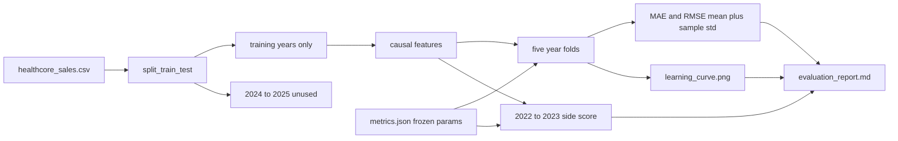

# Regression model evaluation

Evaluate the existing one-month-ahead HealthCore forecast. Do not train a new model, retune, touch 2024–2025, or change the API. Stay on branch `regression-model-eval`. No commit unless asked.

## Locked decisions

- Primary metric is MAE in USD. `CONTEXT.md` does not say whether guessing high or low is worse. RMSE is reported beside MAE. The report states that the direction of the cost is unknown.
- The fit label and the staging sentence come from the training-period checks and the learning curve. 2024–2025 is not an input to either.
- Five expanding year folds on all training feature rows. Expected validation years are 2019, 2020, 2021, 2022, and 2023, with at least two earlier feature-years in each training side. The report says the 2019–2021 folds overlap the months that chose the settings, so that part of the mean can look rosy. Also print one extra score: fit on the pre-2022 selection rows and score 2022–2023 one month at a time. That extra score is not a sixth fold and does not choose the model.
- Settings stay frozen at the values already stored in [`data/eval/sales_forecast/metrics.json`](data/eval/sales_forecast/metrics.json): 100 trees, depth 5, `min_samples_leaf` 2, seed 42. If that file disagrees, stop.
- Training error means in-sample predictions on the months just used to fit that fold.
- Inside a validation year, a month may use the real revenue from earlier months. That is the existing one-month-ahead contract. `revenue_lag_12` remains the seasonal-naive baseline on those same folds.
- Learning-curve image: [`data/eval/sales_forecast/learning_curve.png`](data/eval/sales_forecast/learning_curve.png). Two lines only (training MAE and validation MAE). Fold spread goes in the table, not in a shaded band.
- Written report: [`data/eval/evaluation_report.md`](data/eval/evaluation_report.md). Fold numbers also go to [`data/eval/sales_forecast/cv_metrics.json`](data/eval/sales_forecast/cv_metrics.json).
- No new packages. Sample standard deviation divides by 4 (`ddof=1`).

## What stays untouched

[`scripts/sales_forecast/sales_forecast/pipeline.py`](scripts/sales_forecast/sales_forecast/pipeline.py) keeps writing the 2024–2025 metrics and plot. Reuse [`features.py`](scripts/sales_forecast/sales_forecast/features.py), [`model.fit_random_forest`](scripts/sales_forecast/sales_forecast/model.py), [`model.expanding_year_folds`](scripts/sales_forecast/sales_forecast/model.py), [`metrics.regression_errors`](scripts/sales_forecast/sales_forecast/metrics.py), and [`split.split_train_test`](scripts/sales_forecast/sales_forecast/split.py). Do not change their behavior.



## Evaluation module

Add [`scripts/sales_forecast/sales_forecast/evaluation.py`](scripts/sales_forecast/sales_forecast/evaluation.py).

- Load the frozen hyperparameters from `metrics.json`. Refuse to run when the file is missing or the three settings differ from 100 / 5 / 2.
- Split first, then build features from the training raw frame only. Drop the lag-12 warmup with the existing helper. Require one row per month and `region == consolidated`. Duplicate months or extra regions raise a clear error.
- Build folds with the existing `expanding_year_folds` on that training feature frame. Assert exactly five folds and validation years 2019–2023. For every fold, require sorted timestamps and `max(train time) < min(validation time)`.
- For each fold, fit the frozen forest on the training side, predict that same training side, and predict the validation year. Record training and validation MAE and RMSE in USD, plus the seasonal-naive validation MAE from `revenue_lag_12`.
- Summarize MAE and RMSE as mean ± sample standard deviation across the five folds.
- Side score: fit once on `feat_train.iloc[:-24]` and score the last 24 training months. Record MAE and RMSE. Do not fold this into the mean.
- Learning curve uses the same five folds. X-axis is the number of training months. Y-axis is MAE in USD. Title, axis labels, and legend name the metric. Save the PNG with matplotlib `Agg`, matching [`plot.py`](scripts/sales_forecast/sales_forecast/plot.py). No shaded band.
- Write `cv_metrics.json` with fold rows, both summaries, the side score, the diagnosis, and the frozen settings.

## Diagnosis rule

Apply this rule in code after the numbers exist, so the label is not chosen by hand:

- Let the late gap be the average of `(validation MAE - training MAE) / validation MAE` on the 2022 and 2023 folds.
- **Overfitting** when that late gap is at least 0.5. The gap is still large after more history. The next action names the frozen leaf size of 2 and depth of 5, and points to a larger leaf size or a shallower depth.
- **Underfitting** when the late gap is below 0.5 and the mean validation MAE is greater than or equal to the mean seasonal-naive validation MAE. The errors have come together, and they are no better than same-month-last-year. The next action names the lag and rolling feature family. Do not recommend more trees first.
- **Reasonably well fitted** when the late gap is below 0.5 and the mean validation MAE is below the seasonal-naive mean. The staging sentence can recommend a staging review. It must list the sample standard deviation, the rosy 2019–2021 overlap, and the unknown over/under cost.

The report explains these cuts in dollars. It also shows the 2022–2023 side score as a limitation, not as a replacement verdict.

## Report

Generate [`data/eval/evaluation_report.md`](data/eval/evaluation_report.md) from the results object. Include the company context, target `revenue_usd`, consolidated series, monthly one-step horizon, 2016–2023 versus the unused 2024–2025 boundary, the frozen forest and feature list, the five fold rows, both metrics as mean ± sample standard deviation, the learning-curve interpretation, the single diagnosis, the specific next action, and reproducibility notes. Every dollar figure is written by the script.

## Entry point

Add [`scripts/eval_sales_forecast.py`](scripts/eval_sales_forecast.py) using the same venv re-exec pattern as [`scripts/train_sales_forecast.py`](scripts/train_sales_forecast.py). It calls the new evaluation module and does not score the test set.

## Tests

Add [`tests/pipelines/test_sales_forecast_evaluation.py`](tests/pipelines/test_sales_forecast_evaluation.py) and register it in the `testpaths` list in [`scripts/sales_forecast/pyproject.toml`](scripts/sales_forecast/pyproject.toml). Existing forecast tests stay as they are.

Cover:

- Chronological order, forward-moving validation years, and no future training row on a small synthetic monthly series.
- Duplicate months and a second region raise.
- Features built from the training years only match the training slice of features built from the full series, using a series whose values make any future leak obvious.
- Lag-1 and the three-month rolling mean on a synthetic series equal the earlier revenues only.
- The diagnosis function returns each of the three labels on hand-built summaries, including the 0.5 gap boundary.
- Sample standard deviation of a known five-number sample uses the divide-by-4 definition.
- The report writer includes the diagnosis and the mean ± sample-std line, and it does not describe 2024 or 2025 as a cross-validation fold.

## Validation and memory

Run:

```bash
uv --directory scripts/sales_forecast run pytest
uv --directory scripts/sales_forecast run python ../eval_sales_forecast.py
```

Confirm the PNG opens and the report’s numbers match `cv_metrics.json`. Then update [`memory-bank/context.md`](memory-bank/context.md), [`memory-bank/spec.md`](memory-bank/spec.md), [`memory-bank/progress.md`](memory-bank/progress.md), and [`memory-bank/decisions.md`](memory-bank/decisions.md). After the checks pass, extend [`memory-bank/implementation-memory/sales-forecast.md`](memory-bank/implementation-memory/sales-forecast.md) with the evaluation behavior. Leave the iteration unarchived.
